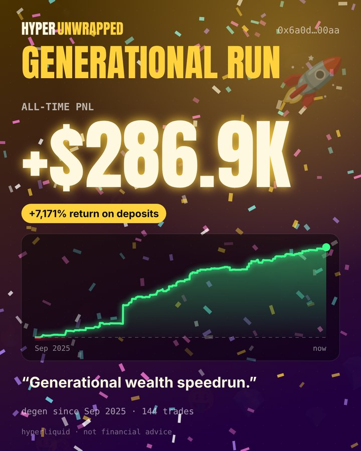
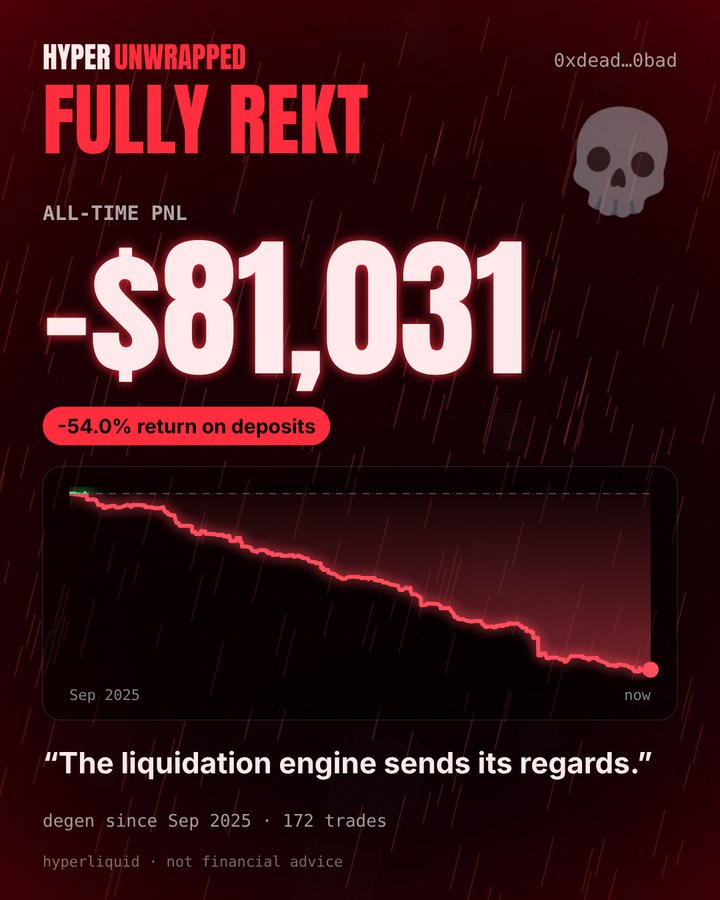
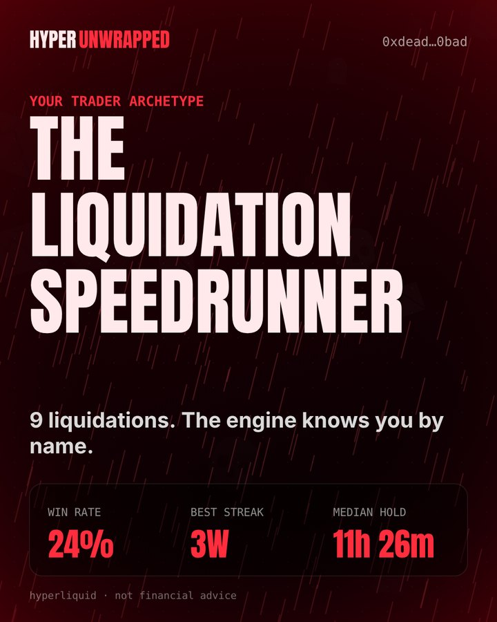
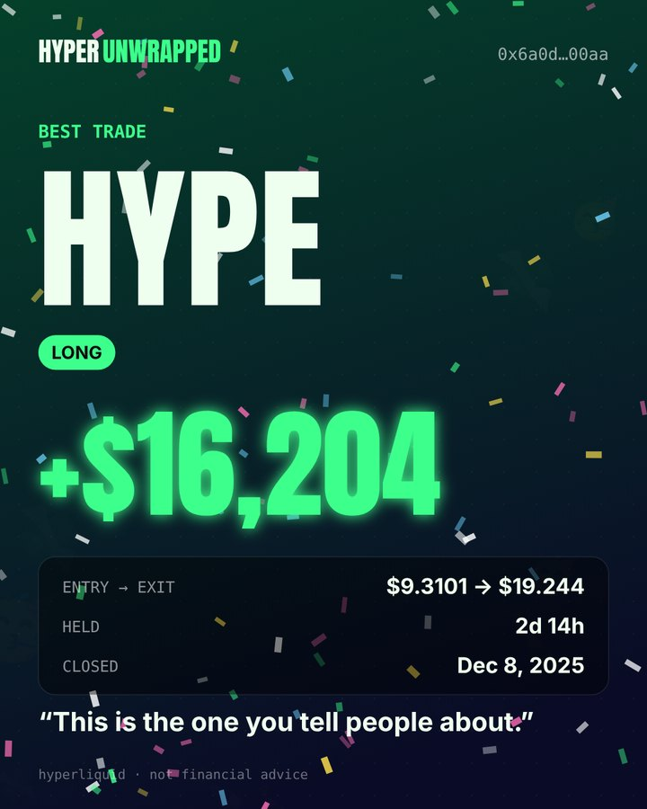
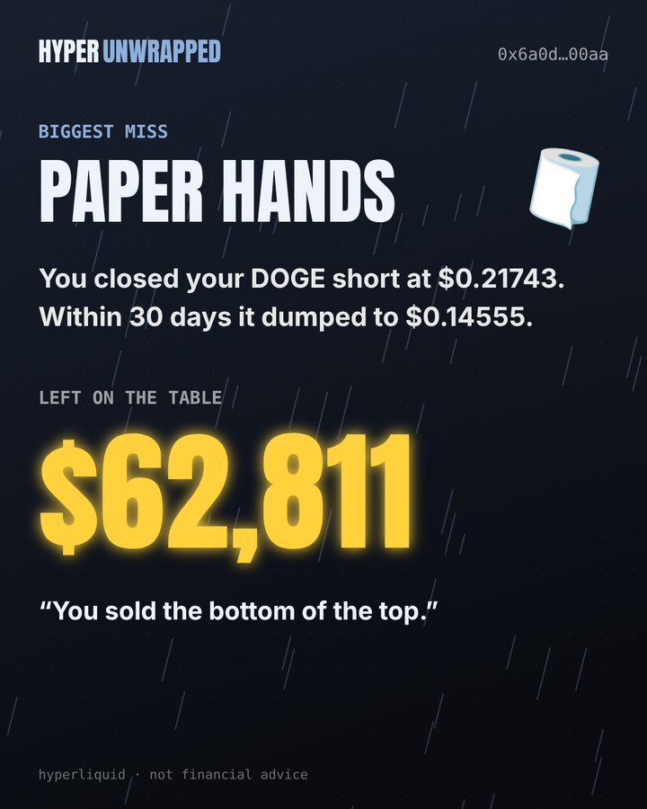
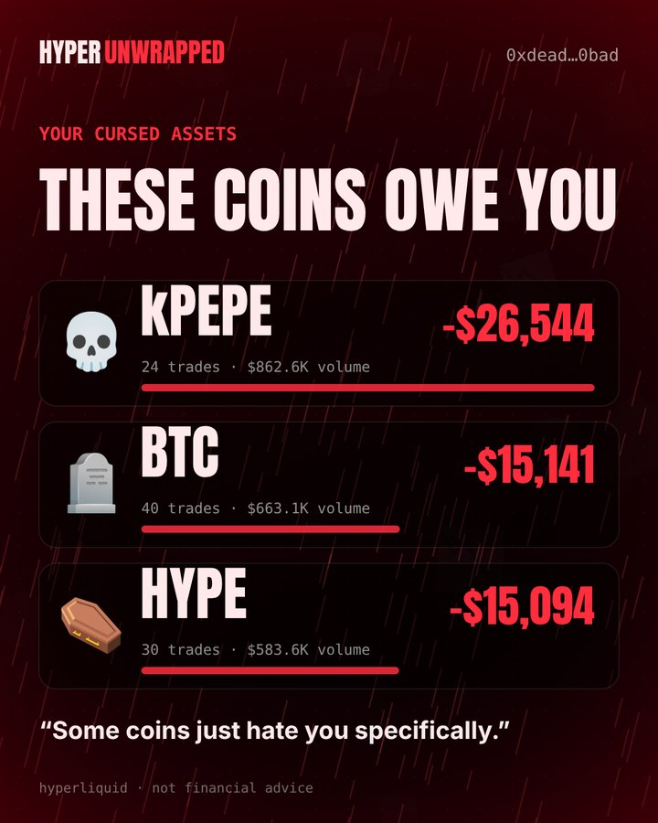
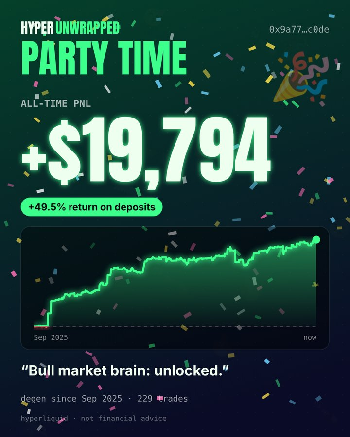
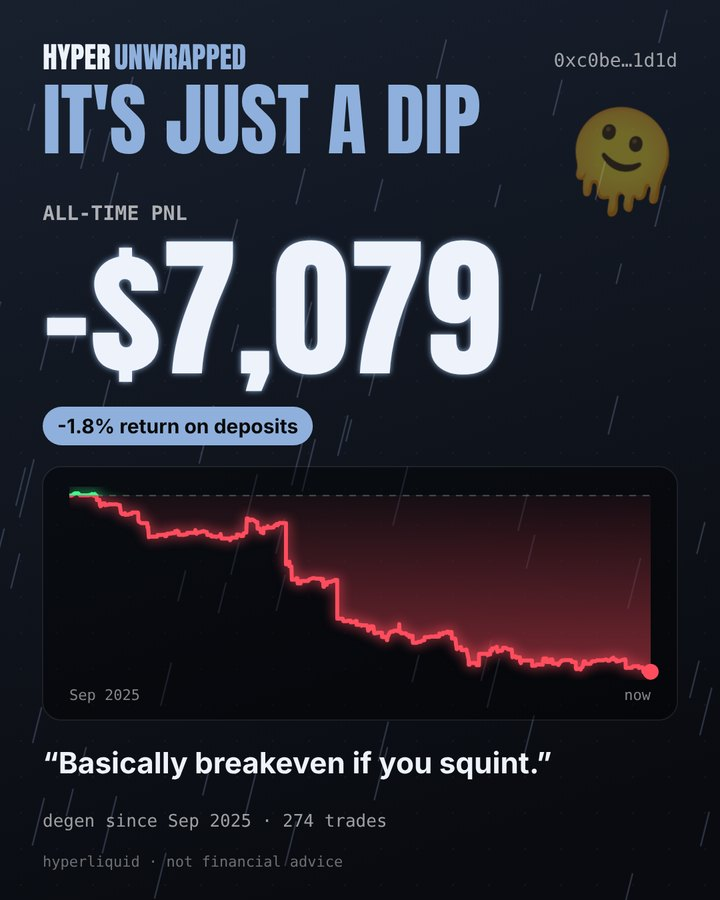
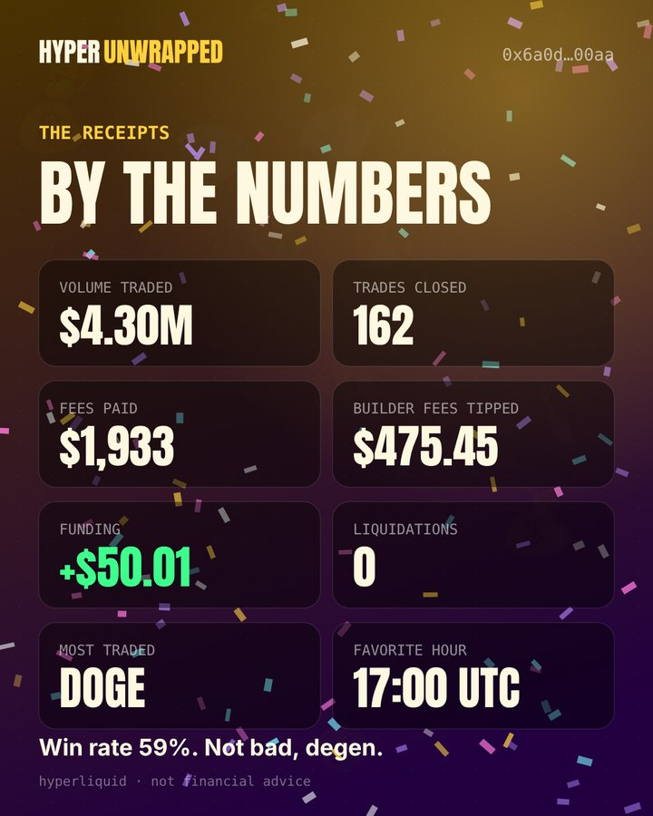

# Hyper Unwrapped

**Your Hyperliquid trading, unwrapped.** Paste any Hyperliquid address and get shareable PnL cards: best trade, worst trade, cursed assets, biggest miss and what kind of degen you really are.

**Live:** https://andrewdamelio.github.io/hyperliquid-unwrapped/

<p>
  
  
  
</p>
<p>
  
  
  
</p>
<p>
  
  
  
</p>

<sub>Cards above are from the built-in demo accounts (synthetic data).</sub>

## The cards

| Card | What it shows |
| --- | --- |
| **All-time PnL** | Hyperliquid's own PnL history, return on deposits, PnL chart |
| **Trader archetype** | Liquidation Speedrunner, Memecoin Mercenary, Fee Donor, Funding Farmer, Sniper, Paper/Diamond Hands… |
| **Best / worst trade** | Market, side, entry → exit, hold time, liquidation stamp |
| **Money printers / cursed assets** | Top and bottom 3 coins by PnL, including fees and funding |
| **Biggest miss** | How much more you'd have made holding 30 days past your exit |
| **Current bags** | Open positions and unrealized PnL |
| **The receipts** | Volume, fees, builder fees, funding, liquidations, favorite hour |

The look scales with performance:

| Return on deposits | Mood |
| --- | --- |
| over +100% | 🚀 **Generational run**: gold, rockets, money bags |
| +10% to +100% | 🎉 **Party time**: confetti, champagne |
| 0 to +10% | 😏 **Technically profitable** |
| 0 to −10% | 🫠 **It's just a dip**: grey drizzle |
| −10% to −50% | 😭 **Down bad**: rain |
| below −50% | 💀 **Fully rekt**: skulls, tombstones, blood-red |

The further from zero, the flashier it gets.

## How it works

Everything runs in the browser against Hyperliquid's public [Info API](https://hyperliquid.gitbook.io/hyperliquid-docs/for-developers/api/info-endpoint). Nothing is stored or sent anywhere else.

1. **Fetch** (`src/api`): `userFillsByTime` (paged, 2,000 per call), `userFunding`, `portfolio`, `clearinghouseState`, and `spotMeta` to name spot coins.
2. **Rebuild trades** (`src/analysis/trades.ts`): replays fills to rebuild each position from open to flat, handling scaling in, partial closes, flips, liquidations and history that starts mid-position.
3. **Analyze** (`src/analysis`): headline PnL comes from Hyperliquid's own history, so it includes fees and funding. Return is measured against the most ever deposited. The biggest miss uses `candleSnapshot` for the 30 days after your largest exits.
4. **Render** (`src/cards`, `src/render`): each card is drawn on a 1080×1350 canvas, so it saves and shares as a crisp PNG.

Hyperliquid serves an account's most recent 10,000 fills, so very active accounts are recapped from those.

## Project structure

```
src/
  api/hyperliquid.ts     typed Info API client: pagination, retries
  analysis/
    trades.ts            rebuild position lifecycles from fills
    stats.ts             pnl, return, rankings, streaks
    archetypes.ts        trader archetype rules
    miss.ts              biggest-miss calculation
  cards/                 one renderer per card + deck order (index.ts)
  render/                canvas helpers, background effects, pnl chart
  ui/                    story viewer, share/save, animated background
  demo/demo.ts           deterministic demo accounts
  moods.ts               mood thresholds, colors, quips
web/index.html           page shell (Vite entry)
tests/                   unit tests for trade rebuilding and stats
docs/                    production build (served by GitHub Pages)
```

Adding a card means writing a function `(ctx) => Card | null` in `src/cards/` and listing it in `src/cards/index.ts`.

## Development

```bash
npm install
npm run dev        # local dev server
npm test           # unit tests (vitest)
npm run build      # type-check + build to docs/
```

GitHub Pages serves the committed `docs/` folder (Settings → Pages → Deploy from a branch → `main` / `/docs`). Run `npm run build` and commit `docs/` to deploy.

---

Not financial advice. Independent fan tool, not affiliated with Hyperliquid.
